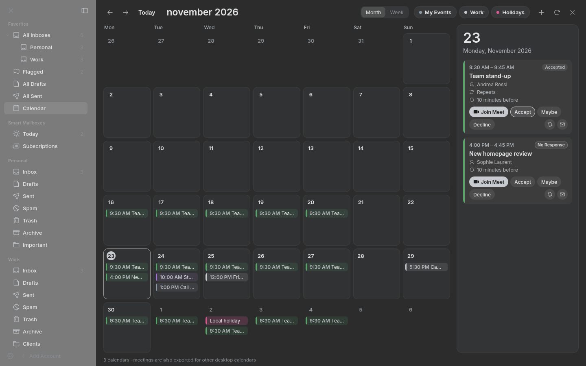
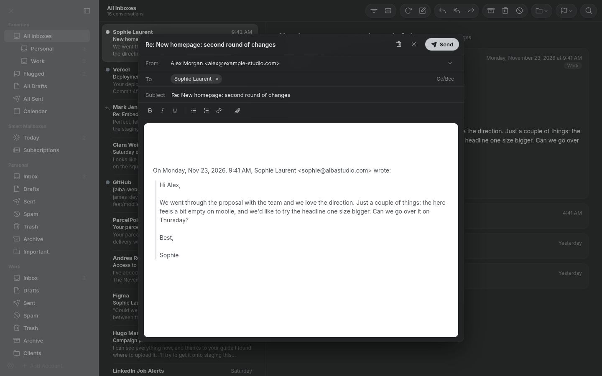

# TuxMail

**Cliente de correo para Linux: rápido, minimalista y privado.**
Conversaciones bien hiladas, imágenes protegidas contra el rastreo, traductor inglés → español que funciona sin internet y todo tu correo guardado solo en tu equipo.

> *English:* TuxMail is a fast, minimal and private desktop email client for Linux (IMAP/SMTP), built with Electron and React. Threaded conversations, tracking-pixel protection, an offline English → Spanish translator (Bergamot) and a local cache. The interface is in Spanish for now. Licensed under GPL-3.0-or-later.




## Qué tiene

- **Conversaciones**: una fila por hilo, con tus respuestas dentro y el texto citado plegado en un «···».
- **Abre los correos al momento**: guarda una copia local de los últimos tres meses y descarga en segundo plano los que tienes alrededor. El correo nuevo llega al instante (IMAP IDLE).
- **Imágenes sin rastreo**: las imágenes remotas se descargan cuando llega el correo, no cuando lo abres, así que el remitente no sabe si lo has leído ni cuándo. Los píxeles espía conocidos se bloquean siempre y el correo nunca se conecta a internet por su cuenta.
- **Traductor inglés → español local**: con el motor de Firefox Translations (Bergamot). El texto de tus correos no sale de tu equipo. Atajo `Ctrl+Shift+T`, y una opción para traducir siempre.
- **Menú de clic derecho**: responder citando lo seleccionado, traducir una selección, copiar imágenes y adjuntos como archivos (se pegan en el gestor de archivos, en un chat o en otro correo), nuevo correo a una persona…
- **Redactar**: responder y reenviar con la cita bien formateada y el hilo intacto (`In-Reply-To`/`References`), pegar o arrastrar archivos e imágenes, y borradores que se guardan solos.
- **Calendario**: las invitaciones que llegan por correo (Google Meet, Teams, Zoom…) se convierten en eventos con **Unirse** y **Aceptar / Quizá / Rechazar**, que responde al organizador como cualquier calendario. Se actualizan solas si cambian o se cancelan. Puedes suscribirte también a calendarios por enlace iCal (festivos, la dirección secreta de Google Calendar…). Vista mes y semana, sin necesidad de entrar con Google ni Microsoft.
- **Eventos propios y avisos**: crea eventos o notas con «+», doble clic o clic derecho en un día (o en una hora de la semana), o desde un correo («Crear evento con este correo…», que queda enlazado). Cualquier evento puede tener avisos (al empezar, 5, 10, 15 o 30 minutos, 1, 2 u 8 horas, 1 o 2 días, o 1 semana antes), que salen como notificación del sistema.
- **Suscripciones**: todos los boletines que te escriben, con cuántos correos mandan y cuántos no lees, y **darse de baja** en un clic (la baja de un clic del RFC 8058 sin abrir ninguna web, o el correo de baja desde tu cuenta; su web solo si no ofrecen otra cosa). Después, sus correos a la papelera de una vez. También hay un botón «Darse de baja» junto al remitente de cada boletín.
- **Vista rápida** de imágenes y PDF con la barra espaciadora.
- **Deshacer** (`Ctrl+Z`) para archivar, borrar, mover y marcar.
- **En la bandeja del sistema**: al cerrar la ventana TuxMail sigue en la bandeja (StatusNotifierItem, como Slack o Discord) para que lleguen el correo nuevo y los avisos; desde el icono se abre, se busca correo nuevo, se escribe uno o se sale. `--oculto` arranca solo en la bandeja (para iniciarlo con la sesión).
- **Ajustes** (la rueda de abajo a la izquierda): color de resaltado, disposición, traducción, cuentas, calendarios y qué se ve en la barra lateral (favoritos y carpetas de cada cuenta; también con clic derecho → «Ocultar»).
- **Colores de resaltado** a elegir y una estética oscura y sobria (paleta *Niebla*).

| | |
|---|---|
|  |  |
|  |  |

## Cuentas compatibles

Al añadir una cuenta solo pides tu dirección: TuxMail busca la configuración como hace Thunderbird (proveedores conocidos, registros MX, la base de datos de proveedores de Mozilla y el autoconfig del dominio). Si no la encuentra, se pone a mano.

| Proveedor | Cómo se entra |
|---|---|
| Gmail y Google Workspace | [Contraseña de aplicación](https://myaccount.google.com/apppasswords) (requiere la verificación en dos pasos) |
| Outlook, Hotmail y Microsoft 365 | «Continuar con Microsoft» (OAuth), si tu compilación tiene un client ID (ver abajo) |
| iCloud | Contraseña específica para apps |
| Yahoo, Fastmail | Contraseña de aplicación |
| Proton | Con [Proton Mail Bridge](https://proton.me/mail/bridge) abierto |
| Cualquier servidor IMAP/SMTP | Usuario y contraseña |

Las contraseñas y los tokens se guardan en el **llavero del sistema** (libsecret: GNOME Keyring, KWallet…), nunca en archivos. La configuración de las cuentas está en `~/.config/tuxmail/cuentas.toml`.

## Instalación desde el código

Necesitas Linux, [Node.js 24](https://nodejs.org), [pnpm](https://pnpm.io) y `secret-tool` (paquete `libsecret`).

```sh
git clone https://github.com/hxst1/tuxmail.git
cd tuxmail
pnpm install
pnpm instalar   # compila e instala TuxMail para tu usuario (sin root)
```

`pnpm instalar` deja la app en `~/.local/lib/tuxmail`, el lanzador `tuxmail` en `~/.local/bin` y su entrada en el lanzador de aplicaciones (con icono y para abrir los enlaces `mailto:`). Para actualizar, vuelve a ejecutarlo. Para que arranque con la sesión, solo en la bandeja, añade `tuxmail --oculto` a los programas de inicio de tu escritorio (en Hyprland: `exec-once`).

Para desarrollar:

```sh
pnpm dev        # con tus cuentas
pnpm demo       # con correos de ejemplo, sin conectarse a nada
```

Si Electron no arranca tras `pnpm install`, puede que pnpm no haya ejecutado su script de instalación: `pnpm approve-builds` (o `node node_modules/electron/install.js`).

### Inicio de sesión con Microsoft (opcional)

Outlook.com ya no admite contraseñas normales por IMAP, así que hace falta OAuth. Registrar la app es gratis:

1. En [Microsoft Entra → Registros de aplicaciones](https://entra.microsoft.com/#view/Microsoft_AAD_RegisteredApps/ApplicationsListBlade), crea una nueva con *Cuentas de cualquier directorio organizativo y cuentas personales de Microsoft*.
2. En *Autenticación*, añade la plataforma *Aplicaciones móviles y de escritorio* con la URI de redirección `http://localhost`, y activa *Permitir flujos de cliente público*.
3. En *Permisos de API → Microsoft Graph → Delegados*, añade `IMAP.AccessAsUser.All`, `SMTP.Send` y `offline_access`.
4. Arranca TuxMail con el *Id. de aplicación (cliente)*:

```sh
TUXMAIL_MICROSOFT_CLIENT_ID=00000000-0000-0000-0000-000000000000 pnpm dev
```

En una app de escritorio el client ID no es secreto: el inicio de sesión va protegido con PKCE.

*«Continuar con Google» está preparado (`TUXMAIL_GOOGLE_CLIENT_ID` y `TUXMAIL_GOOGLE_CLIENT_SECRET`), pero el permiso de Gmail es restringido: sin verificar la app en Google solo sirve para usuarios de prueba. Por eso Gmail usa contraseña de aplicación.*

## Atajos

| Atajo | Acción |
|---|---|
| `F5` | Obtener correo nuevo |
| `Ctrl+N` | Correo nuevo |
| `Ctrl+R` / `Ctrl+Shift+R` | Responder / responder a todos |
| `Ctrl+Shift+F` | Reenviar |
| `Ctrl+Enter` | Enviar (en la ventana de redactar) |
| `Ctrl+Shift+A` | Archivar |
| `Supr` | A la papelera |
| `Ctrl+Shift+J` | Spam |
| `Ctrl+Shift+L` | Marcar |
| `Ctrl+Shift+U` | Leído / no leído |
| `Ctrl+Shift+T` | Traducir el correo / ver el original |
| `Ctrl+F` | Buscar |
| `Ctrl+Z` | Deshacer |
| `Ctrl+W` · `Ctrl+Q` | Cerrar la ventana (sigue en la bandeja) · salir de TuxMail |
| `←` / `→` · `T` · `N` | En el calendario: anterior / siguiente · hoy · nuevo evento |

## Dónde guarda las cosas

| Qué | Dónde |
|---|---|
| Cuentas | `~/.config/tuxmail/cuentas.toml` |
| Contraseñas y tokens | Llavero del sistema (servicio `tuxmail`) |
| Copia local del correo | `~/.config/tuxmail/tuxmail.db` (SQLite) |
| Adjuntos e imágenes | `~/.cache/tuxmail/` |
| Modelo del traductor | `~/.local/share/tuxmail/traduccion/` (se descarga de Mozilla la primera vez) |
| Reuniones exportadas | `~/.local/share/tuxmail/calendario.ics`, para que otros calendarios del escritorio las enseñen |

Quitar una cuenta en TuxMail borra su configuración, su contraseña y su copia local, pero no toca nada del servidor.

## Licencia

TuxMail es software libre bajo la **GNU GPL v3 o posterior** ([LICENSE](LICENSE)): puedes usarlo, estudiarlo y modificarlo. Si distribuyes una versión modificada, tiene que ser también GPL y con su código.

Usa, entre otros, [Bergamot](https://github.com/browsermt/bergamot-translator) y los modelos de traducción de Mozilla (MPL-2.0), [imapflow](https://github.com/postalsys/imapflow), [Nodemailer](https://nodemailer.com), [DOMPurify](https://github.com/cure53/DOMPurify), [Phosphor Icons](https://phosphoricons.com) e [Inter](https://rsms.me/inter/).
