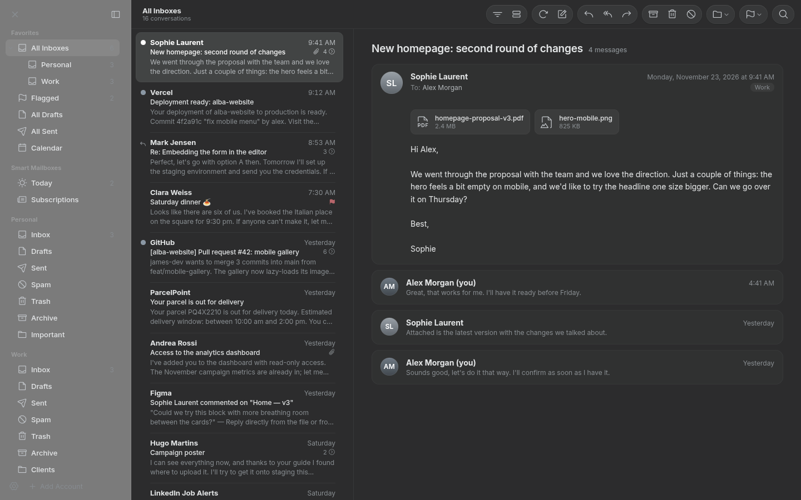
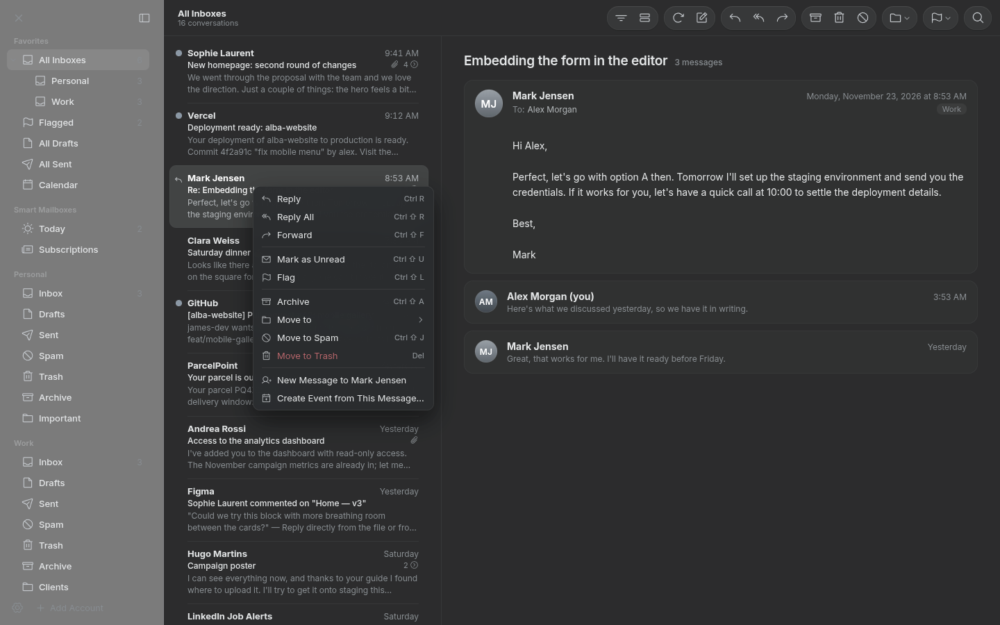
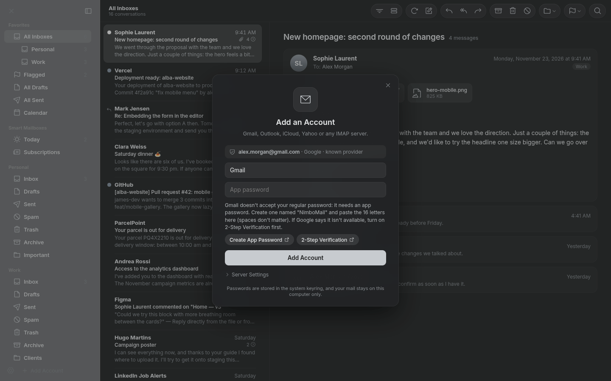
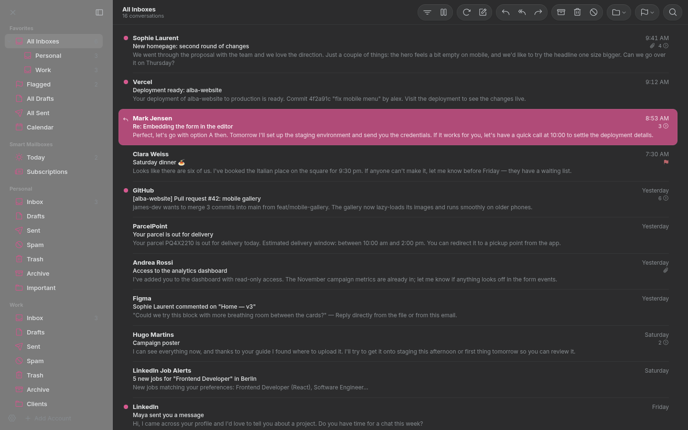

# NimboMail

**A fast, minimal and private desktop email client for Linux.**
Threaded conversations, protection against tracking pixels, a calendar for meeting invites, one-click unsubscribe, and all your mail stored only on your own computer. Works with Gmail, Outlook, iCloud, Yahoo, Fastmail, Proton (via Bridge) and any IMAP/SMTP server. A lightweight, modern alternative to Thunderbird, Geary or Evolution, with a dark, quiet look.

[](LICENSE)


Available in **English** and **Spanish**: it follows your system language and you can switch it in Settings. Issues, pull requests and new translations are welcome.




## Features

- **Conversations**: one row per thread, with your own replies inside and quoted text folded behind a "···".
- **Opens mail instantly**: it keeps a local copy of the last three months and prefetches the messages around the one you are reading in the background. New mail arrives instantly (IMAP IDLE).
- **Images without tracking**: remote images are downloaded when the email arrives, not when you open it, so the sender can't tell whether or when you read it. Known spy pixels are always blocked, and an email never connects to the internet on its own.
- **Offline translator** (when the app is in Spanish): translates English emails into Spanish with the Firefox Translations engine (Bergamot). The text of your emails never leaves your computer. Shortcut `Ctrl+Shift+T`, plus an option to always translate.
- **Right-click menu**: reply quoting the selection, copy images and attachments as files (paste them into your file manager, a chat or another email), new email to a person…
- **Compose**: reply and forward with properly formatted quotes and the thread intact (`In-Reply-To`/`References`), paste or drag files and images, and drafts that save themselves.
- **Calendar**: invitations that arrive by email (Google Meet, Teams, Zoom…) become events with **Join** and **Accept / Maybe / Decline**, which replies to the organizer like any calendar app. They update themselves when changed or cancelled. You can also subscribe to iCal calendars by URL (public holidays, your Google Calendar secret address…). Month and week views, no Google or Microsoft sign-in required.
- **Your own events and reminders**: create events or notes with "+", a double click or a right click on a day (or on an hour in week view), or from an email ("Create Event from This Message…", which stays linked). Any event can have reminders (at start, 5, 10, 15 or 30 minutes, 1, 2 or 8 hours, 1 or 2 days, or 1 week before), shown as system notifications.
- **Subscriptions**: every newsletter that emails you, how many messages each sends and how many you don't read, and **unsubscribe** in one click (RFC 8058 one-click unsubscribe without opening any website, or the unsubscribe email sent from your account; their website only if nothing else is offered). Then move all their emails to the trash at once. There is also an "Unsubscribe" button next to the sender of every newsletter.
- **Quick Look** for images and PDFs with the space bar.
- **Undo** (`Ctrl+Z`) for archive, delete, move and flag.
- **System tray**: when you close the window NimboMail stays in the tray (StatusNotifierItem, like Slack or Discord) so new mail and reminders keep arriving; from the icon you can open it, check for mail, write a message or quit. `--hidden` starts it in the tray only (for autostart).
- **Settings** (the gear at the bottom left): language, accent color, layout, translation, accounts, calendars and what shows in the sidebar (favorites and each account's folders; also via right click → "Hide from Sidebar").
- **Accent colors** to choose from and a dark, sober look (the *Niebla* palette).

| | |
|---|---|
|  |  |
|  |  |

## Supported accounts

When adding an account you only type your address: NimboMail finds the settings the way Thunderbird does (known providers, MX records, Mozilla's ISP database and the domain's autoconfig). If it can't find them, you can enter them by hand.

| Provider | How to sign in |
|---|---|
| Gmail and Google Workspace | [App password](https://myaccount.google.com/apppasswords) (requires 2-Step Verification) |
| Outlook, Hotmail and Microsoft 365 | "Continue with Microsoft" (OAuth), if your build has a client ID (see below) |
| iCloud | App-specific password |
| Yahoo, Fastmail | App password |
| Proton | With [Proton Mail Bridge](https://proton.me/mail/bridge) running |
| Any IMAP/SMTP server | Username and password |

Passwords and tokens are stored in the **system keyring** (libsecret: GNOME Keyring, KWallet…), never in files. Account settings live in `~/.config/nimbomail/cuentas.toml`.

## Download

Grab the latest build from [**Releases**](https://github.com/hxst1/nimbomail/releases/latest):

- **AppImage** (any distro): download `NimboMail-*-x86_64.AppImage`, make it executable and run it.
  ```sh
  chmod +x NimboMail-*-x86_64.AppImage
  ./NimboMail-*-x86_64.AppImage
  ```
  AppImages need FUSE 2 (`sudo pacman -S fuse2` on Arch, `sudo apt install libfuse2` on Debian/Ubuntu). Without it, run it with `--appimage-extract-and-run`.
- **Tarball**: `NimboMail-*-x64.tar.gz`, unpack it anywhere and run `nimbomail` inside.
- **Arch Linux**: build the package from the PKGBUILD in this repo (the AUR package is on its way):
  ```sh
  git clone https://github.com/hxst1/nimbomail.git
  cd nimbomail/packaging/aur && makepkg -si
  ```

You also need `secret-tool` (the `libsecret` package) for the keyring.

## Install from source

You need Linux, [Node.js 24](https://nodejs.org), [pnpm](https://pnpm.io) and `secret-tool` (the `libsecret` package).

```sh
git clone https://github.com/hxst1/nimbomail.git
cd nimbomail
pnpm install
pnpm install-app   # builds and installs NimboMail for your user (no root)
```

`pnpm install-app` puts the app in `~/.local/lib/nimbomail`, the `nimbomail` launcher in `~/.local/bin` and an entry in your application launcher (with an icon, and as the handler for `mailto:` links). To update, run it again. To start it with your session, in the tray only, add `nimbomail --hidden` to your desktop's autostart programs (on Hyprland: `exec-once`).

> **Coming from TuxMail?** It's the same app under a new name. `pnpm install-app` removes the old install and, the first time you open NimboMail (with TuxMail closed), your accounts, passwords, mail and settings move over automatically.

For development:

```sh
pnpm dev        # with your accounts
pnpm demo       # with sample emails, without connecting to anything
```

If Electron doesn't start after `pnpm install`, pnpm may not have run its install script: `pnpm approve-builds` (or `node node_modules/electron/install.js`).

### Sign in with Microsoft (optional)

Outlook.com no longer accepts regular passwords over IMAP, so OAuth is needed. Registering the app is free:

1. In [Microsoft Entra → App registrations](https://entra.microsoft.com/#view/Microsoft_AAD_RegisteredApps/ApplicationsListBlade), create a new one with *Accounts in any organizational directory and personal Microsoft accounts*.
2. Under *Authentication*, add the *Mobile and desktop applications* platform with the redirect URI `http://localhost`, and enable *Allow public client flows*.
3. Under *API permissions → Microsoft Graph → Delegated*, add `IMAP.AccessAsUser.All`, `SMTP.Send` and `offline_access`.
4. Start NimboMail with the *Application (client) ID*:

```sh
NIMBOMAIL_MICROSOFT_CLIENT_ID=00000000-0000-0000-0000-000000000000 pnpm dev
```

In a desktop app the client ID isn't a secret: sign-in is protected with PKCE.

*"Continue with Google" is ready (`NIMBOMAIL_GOOGLE_CLIENT_ID` and `NIMBOMAIL_GOOGLE_CLIENT_SECRET`), but the Gmail scope is restricted: without verifying the app with Google it only works for test users. That's why Gmail uses an app password.*

## Keyboard shortcuts

| Shortcut | Action |
|---|---|
| `F5` | Check for new mail |
| `Ctrl+N` | New email |
| `Ctrl+R` / `Ctrl+Shift+R` | Reply / reply all |
| `Ctrl+Shift+F` | Forward |
| `Ctrl+Enter` | Send (in the compose window) |
| `Ctrl+Shift+A` | Archive |
| `Delete` | Move to trash |
| `Ctrl+Shift+J` | Spam |
| `Ctrl+Shift+L` | Flag |
| `Ctrl+Shift+U` | Read / unread |
| `Ctrl+Shift+T` | Translate the email / show the original |
| `Ctrl+F` | Search |
| `Ctrl+Z` | Undo |
| `Ctrl+W` · `Ctrl+Q` | Close the window (stays in the tray) · quit NimboMail |
| `←` / `→` · `T` · `N` | In the calendar: previous / next · today · new event |

## Where your data lives

| What | Where |
|---|---|
| Accounts | `~/.config/nimbomail/cuentas.toml` |
| Passwords and tokens | System keyring (service `nimbomail`) |
| Local copy of your mail | `~/.config/nimbomail/nimbomail.db` (SQLite) |
| Attachments and images | `~/.cache/nimbomail/` |
| Translation model | `~/.local/share/nimbomail/traduccion/` (downloaded from Mozilla the first time) |
| Exported meetings | `~/.local/share/nimbomail/calendario.ics`, so other desktop calendars can show them |

Removing an account in NimboMail deletes its settings, its password and its local copy, but doesn't touch anything on the server.

## License

NimboMail is free software under the **GNU GPL v3 or later** ([LICENSE](LICENSE)): you can use, study and modify it. If you distribute a modified version, it must also be GPL and come with its source code.

It uses, among others, [Bergamot](https://github.com/browsermt/bergamot-translator) and Mozilla's translation models (MPL-2.0), [imapflow](https://github.com/postalsys/imapflow), [Nodemailer](https://nodemailer.com), [DOMPurify](https://github.com/cure53/DOMPurify), [Phosphor Icons](https://phosphoricons.com) and [Inter](https://rsms.me/inter/).
